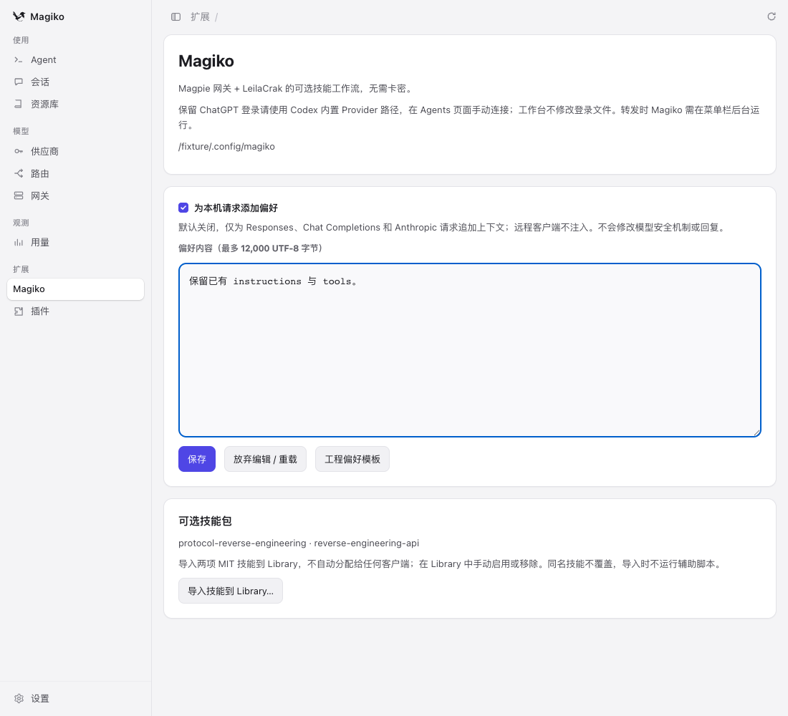

# Magiko

**A macOS gateway and workspace based on [yetone/magpie](https://github.com/yetone/magpie), with optional context preferences and MIT skills extracted from LeilaCrak.**

Magiko is an independent fork, not an official Magpie or OpenAI release. It has no activation-card system. This first preview is **macOS Apple Silicon only**.

## 下载 / Download

[Releases](https://github.com/NorwayXZ/Magiko/releases) · [上游完整功能说明](README.upstream.md)

解压后将 `Magiko.app` 拖入 Applications。初次启动在菜单栏中打开主窗口。
预览包使用本地 ad-hoc 签名，尚未使用 Apple Developer ID 签名或公证。若 macOS 阻止首次启动，可在系统设置 → 隐私与安全性中检查并按需允许。



## 融合了什么

- **Magpie 底座**：模型网关、Provider/账号管理、路由、用量、Library、菜单栏后台运行。
- **Magiko 工作台**：可选的本机请求偏好；支持 Responses、Chat Completions、Anthropic Messages。默认关闭，不改变模型、工具参数、流式开关和回复。
- **LeilaCrak 技能工作流**：两项 MIT 技能 `protocol-reverse-engineering`、`reverse-engineering-api`，带原许可证。一键导入 Library，**不自动分配给客户端**。到 Library → Skills 选择目标客户端；移除也在 Library 操作。
- **独立运行身份**：`~/.config/magiko`、`~/.cache/magiko`、默认 `127.0.0.1:3525`、独立登录启动与后台服务标识，不覆盖 Magpie 的数据。

未合入原软件的卡密、全局授权状态、“无限制”模板、拒答自动重试或输出清洗逻辑。普通请求偏好不等于修改模型，也不保证所谓“破甲”效果。

## ChatGPT 订阅与 Codex

1. 保留 Codex 原有 ChatGPT 登录。首次安装**不迁移** LeilaCrak 或 Magpie 的配置、账号与密钥。
2. 在 Magiko 的 Agents 页面查看 Codex 状态并**手动连接**；底座保留上游针对内置 Provider 的 `/backend-api/codex` 路径，避免强制切成需要 API Key 的自定义 Provider。
3. 原来被 LeilaCrak 接管的 Codex 配置不会被安装程序偷偷修复；先备份、解除旧代理，再在界面中确认连接方式。
4. 转发时 Magiko 进程需继续运行。关闭主窗口可留在菜单栏后台，不需要一直展示窗口；可在 Settings 中选择登录启动。
5. 已有会话可能仍绑定旧 Provider，连接后用新会话验证。真实订阅登录/用量尚未通过真人账号端到端验证。

不建议 Magpie 与 Magiko 同时管理同一个客户端配置。两者虽然各自保存数据，但客户端自己的 `config.toml`、技能目录仍是共享目标，只有用户显式连接/分配时才写入。

## 工作台

- 填写偏好 → 勾选 → 保存，对下一次本机请求生效。上限 12,000 UTF-8 字节。
- 关闭开关并保存即可停止追加。原请求的已有上下文保留，不删除上游指令。
- 远程/带转发头/网关 Key 的客户端不接收本机个人偏好。
- 导入技能前需确认。已经存在的同名技能不覆盖；安装结果会显示已存在或跳过原因。
- 技能是文本和辅助源码，导入过程不执行脚本，也不安装 Python/浏览器依赖。
- 更新暂时从本仓库 Releases 手动下载，**不使用 Magpie 的自动更新源**。

## 构建

需要 Apple Silicon Mac、Go 1.26.8（go.mod 允许自动下载 toolchain）、Xcode Command Line Tools。

```sh
git clone https://github.com/NorwayXZ/Magiko.git
cd Magiko
VERSION=0.1.0-preview.1 build/magiko/build.sh
# dist/Magiko.app
# dist/Magiko-0.1.0-preview.1-mac-arm64.zip
python3 build/magiko/smoke.py  # 可选：隔离环境启动自检，不读取真实账号
```

`-tags magiko` 启用独立身份；普通 `make` 仍遵循上游行为，方便追踪上游测试。
Go module 继续使用 `github.com/yetone/magpie`，不伪造来源、不大范围重写导入路径。

开发服务器请使用临时 HOME，并先固定 `GOPATH`、`GOMODCACHE`、`GOCACHE`。不要把真实 Codex 凭据带入测试环境。

## 验证与架构

- [融合架构与边界](docs/magiko/architecture.md)
- [测试记录与已知限制](docs/magiko/verification.md)
- [来源与许可](docs/magiko/attribution.md)

上游发布、Docker 和网站 CI 已保存在 `.github/upstream-workflows/`，不在 fork 中执行；新的 Magiko CI 只验证和产出构建工件，不自动发版。

## License

Magpie 和 Magiko 的代码沿用 [MIT](LICENSE)。第三方技能各自的 LICENSE 随包保留。
